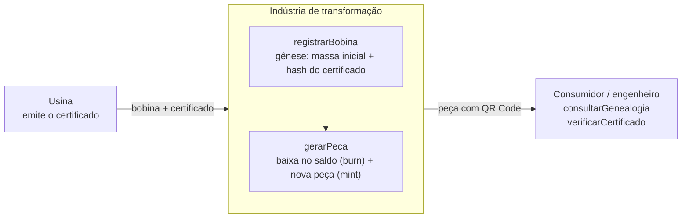

# MetalChain

**Rastreabilidade de aço fracionado em blockchain.** Na indústria de transformação,
o certificado de origem emitido pela usina acompanha a bobina, mas não as peças
cortadas dela. O MetalChain preserva, de forma imutável e pública, o vínculo entre
cada peça derivada e o certificado da bobina-mãe. Um controle de massa impede que
mais aço seja atribuído a um certificado do que o registrado na origem.

> Protótipo desenvolvido como Trabalho de Conclusão de Curso do Bacharelado em
> Sistemas de Informação do **Ifes, Campus Cachoeiro de Itapemirim** (2026).
> **Autor:** Rui de Souza Fontoura Junior · **Orientador:** Prof. Dr. João Paulo de Brito Gonçalves

---

## Sumário

- [Para a banca examinadora](#para-a-banca-examinadora)
  - [Verificação em 5 minutos](#verificação-em-5-minutos)
  - [Onde cada requisito está implementado](#onde-cada-requisito-está-implementado)
  - [Cenários de teste](#cenários-de-teste)
  - [Resultados obtidos](#resultados-obtidos)
  - [Execução na rede Sepolia](#execução-na-rede-sepolia)
  - [Limites do protótipo](#limites-do-protótipo)
- [Como o sistema funciona](#como-o-sistema-funciona)
- [Guia do usuário](#guia-do-usuário)
  - [Pré-requisitos](#pré-requisitos)
  - [Instalação e testes](#instalação-e-testes)
  - [Publicação na rede Sepolia](#publicação-na-rede-sepolia)
  - [Hash do certificado](#hash-do-certificado)
- [Estrutura do repositório](#estrutura-do-repositório)
- [Situação do projeto](#situação-do-projeto)

---

## Para a banca examinadora

### Contrato publicado na rede Sepolia

O contrato está publicado na rede pública de testes da Ethereum e pode ser
conferido por qualquer pessoa no explorador de blocos:

| | |
|---|---|
| **Endereço do contrato** | [`0xCE8A2190A6977e11060D3BD725fD317a12E82370`](https://sepolia.etherscan.io/address/0xCE8A2190A6977e11060D3BD725fD317a12E82370) |
| **Transação de implantação** | [`0xbfd73651…6dde81`](https://sepolia.etherscan.io/tx/0xbfd73651e146b69a520030628a85adcfb307324cd2ef32bee291ec60296dde81) |
| **Credenciamento do operador** | [`0x4e633828…dae56d0`](https://sepolia.etherscan.io/tx/0x4e6338284baa70bb1a49cc4344abe814a3277ca78267fd74a4aa5e085dae56d0) |

### Verificação em 5 minutos

Com o [Node.js](https://nodejs.org) 18 ou superior instalado:

```bash
git clone https://github.com/Ruifon/MetalChain.git
cd MetalChain
npm install
npx hardhat test
```

O resultado esperado é **11 testes aprovados**: os 10 cenários do plano de
validação (Quadro 6 do TCC) e a verificação da invariante de massa em uma
sequência pseudoaleatória de 60 operações. Os testes rodam em uma rede local,
sem custo e sem carteira.

Para reproduzir a medição de custos (Tabelas 1 e 2 do TCC):

```bash
npm run gas
```

### Onde cada requisito está implementado

| Requisito do TCC | Onde está no código | Teste que comprova |
|---|---|---|
| Gênese: registro da bobina com o hash do certificado | `registrarBobina` | CT01, CT06, CT08 |
| Baixa irreversível da massa (*burn*) | `gerarPeca`, linha `bobina.saldo -= massa` | CT02, CT03, CT04 |
| Emissão da peça com herança do certificado por referência (*mint*) | `gerarPeca`, campo `bobinaId` da estrutura `Peca` | CT02, CT09 |
| Bloqueio de atribuição sem lastro | `require(massa <= bobina.saldo, ...)` | CT03, CT04 e teste da invariante |
| Escrita restrita a operadores credenciados | `AccessControl` (OpenZeppelin), papel `OPERADOR` | CT07 |
| Consulta pública, sem carteira e sem custo | `consultarGenealogia` e `consultarBobina` (funções `view`) | CT09 |
| Verificação de integridade do certificado | `verificarCertificado` | CT10 |
| Identificação da indústria que fez cada registro | mapeamento `nomeIndustria` | CT09 |

Todo o contrato está em [`contracts/MetalChain.sol`](contracts/MetalChain.sol),
comentado em português. A ordem das verificações de `gerarPeca` segue a Figura 4
do TCC.

### Cenários de teste

Arquivo: [`test/MetalChain.test.js`](test/MetalChain.test.js)

| ID | Cenário | Resultado esperado |
|---|---|---|
| CT01 | Gênese legítima de uma bobina de 2.000 kg | Bobina gravada, saldo de 2.000 kg |
| CT02 | Três peças somando 1.500 kg | Saldo de 500 kg, invariante preservada |
| CT03 | Peça de 600 kg com saldo de 500 kg (fraude de massa) | Transação revertida, estado inalterado |
| CT04 | Consumo exato do saldo, seguido de nova peça | Primeira aceita (saldo zero), segunda revertida |
| CT05 | Peça a partir de bobina inexistente | Transação revertida |
| CT06 | Registro duplicado do mesmo número de bobina | Transação revertida |
| CT07 | Escrita por carteira sem credenciamento ou revogada | Transação revertida |
| CT08 | Bobina ou peça com massa zero | Transação revertida |
| CT09 | Consulta pública da genealogia por carteira sem papel | Dados retornados sem custo |
| CT10 | Certificado original × cópia com 1 byte alterado | Original confere, cópia diverge |

### Resultados obtidos

Execução em rede local (Hardhat 2.29, Solidity 0.8.24, otimizador ligado com 200 execuções):

- **11 de 11 testes aprovados.** Na sequência pseudoaleatória, 27 operações couberam no
  saldo e foram aceitas, e 33 foram recusadas pelo contrato. A igualdade
  *massa inicial = saldo + soma das peças* se manteve após todas as 60 operações.
- **Custo por operação:**

| Operação | Gas | Custo a 1 gwei (ETH) |
|---|---:|---:|
| Implantação do contrato (uma vez) | 2.112.859 | 0,002113 |
| `credenciarOperador` | 74.544 | 0,000075 |
| `registrarBobina` | 346.619 | 0,000347 |
| `gerarPeca` (descrição de 47 bytes) | 242.572 | 0,000243 |
| `revogarOperador` | 28.036 | 0,000028 |
| Consultas (`consultarGenealogia`, `verificarCertificado`) | 0 | 0 |

- O custo de `gerarPeca` **não cresce** com o número de peças: a 1ª e a 200ª peça
  custaram exatamente o mesmo. O que varia é o tamanho do texto gravado: cada bloco
  de 32 bytes de descrição acrescenta cerca de 22 mil unidades de gas.

### Execução na rede Sepolia

Em 13/10/2026, os cenários centrais foram repetidos no contrato publicado, com o
script [`scripts/cenarios-sepolia.js`](scripts/cenarios-sepolia.js) (Seção 5.5 do TCC).
Cada transação pode ser aberta no Etherscan:

| Cenário | Operação | Resultado | Bloco | Gas | Transação |
|---|---|---|---:|---:|---|
| CT01 | Gênese da bobina `BOB-SEPOLIA-2026-10-13-51249`, 2.000 kg | Aceita | 11907488 | 1.243.323 | [`0x2f908b8b…ac7a`](https://sepolia.etherscan.io/tx/0x2f908b8bbabdef3263e8b717a9a705280a5b08d6c5ba60e5ca2308a86ab0ac7a) |
| CT02 | Peça nº 1, 1.500 kg (saldo: 500 kg) | Aceita | 11907489 | 822.352 | [`0xd802eb17…e518`](https://sepolia.etherscan.io/tx/0xd802eb174f6e98945b3c7d75c7720cf83cad7a60bdc45f0c09c119891c96e518) |
| CT02 | Peça nº 2, 400 kg (saldo: 100 kg) | Aceita | 11907490 | 822.352 | [`0xdff9de11…e98a`](https://sepolia.etherscan.io/tx/0xdff9de117b002871c3aa093b80f4103cda78a77e7b91d492d34d7e296842e98a) |
| CT03 | Peça de 600 kg com saldo de 100 kg | **Revertida**: `MetalChain: massa insuficiente` | 11907491 | 31.640 | [`0xbff4ceca…f131`](https://sepolia.etherscan.io/tx/0xbff4ceca0217406c4c2708b5b3f5c11389b725410e2aa019c8796074cc42f131) |

Leituras públicas, sem transação e sem custo: a genealogia da peça nº 1 retornou a
bobina de origem, a norma ABNT NBR 7480 e a indústria que a registrou; o saldo final
foi de 100 kg; o certificado original
([`certificados/certificado-demonstracao.txt`](certificados/certificado-demonstracao.txt))
conferiu, e uma cópia com um caractere alterado foi rejeitada.

**Por que o gas foi cerca de 4 vezes maior na Sepolia?** O mesmo script, com os mesmos
dados, consumiu 281.503 (gênese) e 198.212 (peça) na rede local. Desde 06/10/2026 a
Sepolia roda a atualização *Glamsterdam*, que inclui a
[EIP-8037](https://eips.ethereum.org/EIPS/eip-8037) e encarece a criação de estado:
uma nova posição de armazenamento passa de 20.000 para 97.920 unidades de gas. A
transação revertida, que não cria estado, custou quase o mesmo nas duas redes
(30.462 × 31.640). A rede principal ainda não tem data para essa atualização
([anúncio](https://blog.ethereum.org/2026/09/17/glamsterdam-testnet-announcement)).

### Limites do protótipo

O sistema garante que **nenhuma peça pode ser vinculada a um certificado acima da
massa declarada na gênese**. Ele **não** garante:

- que a massa e o certificado declarados na gênese correspondem à bobina física.
  No protótipo, a gênese é feita pela indústria de transformação, e cada registro fica
  atribuído à carteira de quem o fez;
- que a etiqueta com o QR Code permanece na peça correta;
- a qualidade física do aço, que continua sendo atestada pelos ensaios e pela
  certificação da usina.

Esses pontos são discutidos nas Seções 4.4.3, 4.6.3 e 5.6 do TCC.

---

## Como o sistema funciona



1. **Gênese.** Ao receber a bobina, um operador credenciado registra o número da bobina,
   o lote, a norma, o grau do aço, a massa inicial e o hash SHA-256 do certificado de
   qualidade. O arquivo do certificado fica no IPFS, e só a referência vai para a rede.
2. **Transformação.** A cada peça cortada ou perfilada, o contrato confere quatro regras
   antes de gravar qualquer dado:

   | Verificação | Se falhar |
   |---|---|
   | A carteira tem o papel de operador? | `AccessControlUnauthorizedAccount` |
   | A bobina de origem existe? | `MetalChain: bobina inexistente` |
   | A massa da peça é maior que zero? | `MetalChain: massa invalida` |
   | A massa cabe no saldo da bobina? | `MetalChain: massa insuficiente` |

   Se tudo passar, o saldo da bobina é reduzido e a peça é gravada com a referência
   à bobina-mãe, na mesma transação. Qualquer falha desfaz a transação inteira.
3. **Consulta.** Qualquer pessoa, sem carteira, consulta a genealogia da peça e
   confere se o certificado que recebeu é o mesmo registrado na gênese. A
   [interface web](web/README.md) faz isso a partir do QR Code da etiqueta.

**Unidades:** massas em **gramas** inteiros (2.000 kg = `2000000`), porque a EVM não
opera com números decimais. Comprimentos em **milímetros**.

---

## Guia do usuário

### Pré-requisitos

- [Node.js](https://nodejs.org) 18 ou superior (versão LTS recomendada)
- [Git](https://git-scm.com)
- Para publicar na rede Sepolia:
  - extensão [MetaMask](https://metamask.io) com uma carteira **exclusiva para testes**;
  - Ether de teste, obtido gratuitamente em um *faucet* da Sepolia;
  - uma URL RPC gratuita ([Alchemy](https://www.alchemy.com) ou [Infura](https://www.infura.io)).

### Instalação e testes

```bash
git clone https://github.com/Ruifon/MetalChain.git
cd MetalChain
npm install
npm run compile      # compila o contrato
npm test             # executa os 11 testes
npm run gas          # mede o gas de cada operação
```

Para o relatório de gas detalhado dos testes, gravado em `relatorio-gas.txt`:

```bash
# Linux / macOS
REPORT_GAS=1 npx hardhat test
# Windows (PowerShell)
$env:REPORT_GAS=1; npx hardhat test
```

### Publicação na rede Sepolia

1. Copie o modelo de configuração:
   ```bash
   cp .env.example .env        # Windows: copy .env.example .env
   ```
2. Preencha o `.env`:

   | Variável | O que colocar |
   |---|---|
   | `SEPOLIA_RPC_URL` | URL RPC da Sepolia (Alchemy ou Infura) |
   | `PRIVATE_KEY` | Chave privada da carteira **de testes**, com `0x` no início |
   | `NOME_INDUSTRIA` | Nome gravado para a carteira administradora |
   | `OPERADOR_CARTEIRA` | Endereço a credenciar como operador (pode ser a mesma carteira) |
   | `OPERADOR_NOME` | Nome da indústria do operador |
   | `ETHERSCAN_API_KEY` | Opcional, para verificar o código no Etherscan |

3. Publique:
   ```bash
   npm run deploy:sepolia
   ```
   O terminal mostra o endereço do contrato, o hash da transação e o link para o
   [Sepolia Etherscan](https://sepolia.etherscan.io), onde qualquer pessoa pode
   conferir os registros.

> **Segurança:** o arquivo `.env` contém a sua chave privada e está no `.gitignore`.
> Nunca o envie ao repositório nem o compartilhe. Use sempre uma carteira criada só
> para testes.

### Cenários na rede Sepolia

Com o contrato publicado, informe o endereço em `CONTRATO_ENDERECO` no `.env` e rode:

```bash
npx hardhat run scripts/cenarios-sepolia.js --network sepolia
```

O script registra uma bobina de 2.000 kg, gera duas peças (1.500 kg e 400 kg),
tenta gerar uma peça de 600 kg com saldo de 100 kg, que o contrato recusa, e faz
as consultas públicas. Os hashes de todas as transações ficam em
`resultados-sepolia.md`, com links para o Etherscan.

### Hash do certificado

Para obter o hash SHA-256 de um certificado (por exemplo, um PDF), no formato
usado por `registrarBobina`:

```bash
node scripts/hash-certificado.js caminho/do/certificado.pdf
```

---

## Estrutura do repositório

```
contracts/MetalChain.sol        contrato inteligente
test/MetalChain.test.js         cenários CT01 a CT10 e invariante de massa
scripts/deploy.js               publicação na Sepolia e credenciamento do operador
scripts/medir-gas.js            gas por operação e evolução do custo de gerarPeca
scripts/hash-certificado.js     SHA-256 de um arquivo em formato bytes32
scripts/cenarios-sepolia.js     repete na Sepolia a gênese, as peças e a tentativa de fraude
certificados/                   certificado de demonstração usado nos cenários
web/                            interface web: consulta por QR Code e área da indústria
hardhat.config.js               configuração do Hardhat e da rede Sepolia
.env.example                    modelo das variáveis de ambiente
```

## Situação do projeto

| Etapa | Situação |
|---|---|
| Contrato inteligente | Concluído |
| Testes automatizados (CT01 a CT10) | Concluídos, 11 de 11 aprovados |
| Medição de custos | Concluída |
| Publicação na rede Sepolia | Concluída ([ver contrato](https://sepolia.etherscan.io/address/0xCE8A2190A6977e11060D3BD725fD317a12E82370)) |
| Cenários repetidos na rede Sepolia | Concluídos em 13/10/2026 ([ver resultados](#execução-na-rede-sepolia)) |
| Interface web (área da indústria e consulta por QR Code) | Pronta, testada em rede local; publicação no Vercel em andamento ([ver `web/`](web/README.md)) |

## Licença

Distribuído sob a licença MIT. Veja [`LICENSE`](LICENSE).
